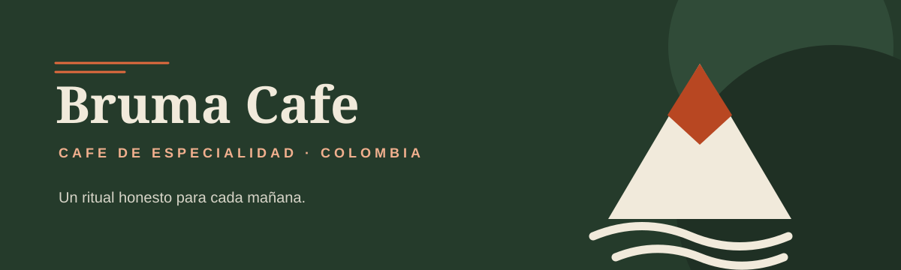

# Participantes

- Isaac Manuel Madera Jimenez
- Brayan Stid Jimenez Arredondo

# Bruma Café

Aplicación web de una tienda de café de especialidad. Proyecto académico construido con HTML, CSS y JavaScript, sin frameworks. Tiene una tienda pública con el catálogo, un formulario de contacto que guarda pedidos en el navegador y un panel de inventario con CRUD, tabla de datos y sincronización con la aplicación Quanty.

## Vistas de la aplicación

Todo vive en `index.html` y se alterna por la ruta del navegador (`#tienda`, `#contacto` y `#panel`), sin recargar la página.

| Ruta | Vista | Qué contiene |
| --- | --- | --- |
| `#tienda` | Tienda | Portada, catálogo con buscador y filtros por categoría, destacados calculados del inventario y datos de confianza |
| `#contacto` | Contacto | Formulario de pedido, pedidos guardados y preguntas frecuentes |
| `#panel` | Panel de inventario | Indicadores, CRUD de productos, tabla de datos con exportación a CSV e integración con Quanty |

## Inicio rápido

No requiere instalación de dependencias ni compilación. Abre la carpeta del proyecto en un editor como Visual Studio Code y ábrelo con la extensión Live Server (o cualquier servidor local).

Las tipografías DM Sans y Fraunces se cargan desde Google Fonts y requieren conexión a Internet; sin ella el navegador usa tipografías de respaldo. Las fotos de los productos son locales, en `assets/`.

## Estructura de archivos

```text
.
├── index.html
├── README.md
├── css/
│   └── styles.css
├── js/
│   ├── modelo/
│   │   ├── modelo.js
│   │   └── reglasTabla.js
│   ├── vista/
│   │   ├── vista.js
│   │   └── pintarTabla.js
│   ├── controlador/
│   │   ├── controlador.js
│   │   └── eventosTabla.js
│   ├── servicios/
│   │   └── api.js
│   └── app.js
└── assets/
    ├── logo.svg
    ├── banner.svg
    └── *.jpg
```

- `index.html`: estructura semántica con las tres vistas (tienda, contacto y panel), formularios, tabla de datos y cuadros de diálogo.
- `css/styles.css`: estilos, distribución con Grid y Flexbox, tema claro y oscuro, estados de foco y adaptación responsive.
- `js/modelo/modelo.js`: productos, reglas de negocio, operaciones CRUD, persistencia (`localStorage`), preferencia de tema, armado del envío a Quanty y comparación del stock recibido. No toca el DOM.
- `js/modelo/reglasTabla.js`: reglas de la tabla: filtros combinados, ordenamiento, paginación y generación del CSV. No toca el DOM.
- `js/vista/vista.js`: cambio de vista por ruta, lectura de formularios, tarjetas, filtros, indicadores, vista previa del producto, destacados y mensajes mediante APIs seguras del DOM. No guarda datos.
- `js/vista/pintarTabla.js`: pintado de la tabla, indicadores de orden y paginación, y descarga del CSV.
- `js/controlador/controlador.js`: eventos, coordinación de las capas y sincronización con Quanty.
- `js/controlador/eventosTabla.js`: estado de la tabla (columna, dirección y página) y sus eventos.
- `js/servicios/api.js`: consumo de la API REST de Quanty con `fetch`, `async`/`await` y manejo de errores.
- `js/app.js`: punto de arranque.
- `assets/logo.svg`: logotipo vectorial usado en encabezado, pie de página y favicon.
- `assets/banner.svg`: banner editorial del proyecto.
- `assets/*.jpg`: fotos locales de los productos.

## Contenido y funcionalidades

- Cabecera con un solo menú de navegación por vistas, enlace para saltar al contenido y un único `h1` por vista.
- Inventario de productos con CRUD completo: crear, listar, editar y eliminar. El formulario se abre en un cuadro de diálogo (`<dialog>`) con vista previa del producto.
- Persistencia del inventario con `localStorage`; los productos sobreviven a recargar la página. El siguiente identificador se guarda aparte (`bruma-cafe-siguiente-id`) y solo sube, así que el id de un producto eliminado nunca se reutiliza. Esto evita que Quanty confunda un producto nuevo con uno antiguo al sincronizar.
- Validaciones de negocio centralizadas en el modelo: nombre mínimo, precio positivo y máximo de $1.000.000, cantidad entera no negativa, categoría válida, nombre único, imagen HTTP/HTTPS y máximo 50 bolsas de grano.
- Agregar, guardar cambios y eliminar piden confirmación con el nombre del producto antes de aplicarse. Los eventos de las filas usan delegación.
- Botón para restaurar los seis productos de ejemplo, con confirmación.
- Indicadores del panel (productos, unidades y valor, stock bajo y agotados) calculados con `filter` y `reduce`. El stock bajo son 5 bolsas o menos.
- Catálogo de la tienda con buscador en vivo, sin distinguir mayúsculas, filtros por categoría combinados con la búsqueda, contador de resultados y aviso sin coincidencias.
- Destacados de la tienda calculados a partir del inventario actual.
- Tabla de inventario con búsqueda, filtros combinados (categoría y disponibilidad: disponibles, stock bajo y agotados), ordenamiento por columna, paginación de 5 filas y exportación a CSV de los registros filtrados.
- Formulario de contacto con validación del navegador; al enviar muestra un mensaje con el nombre, limpia el formulario y guarda el pedido en `localStorage`, desde donde puede eliminarse.
- Sincronización con Quanty: envío de productos y contactos a la API REST de Quanty, con indicador de carga, resultado en pantalla y mensajes de error claros.
- Consulta del stock de Quanty: el botón "Traer stock de Quanty" recibe las cantidades actuales y las compara con el inventario local en una tabla, con la diferencia y el estado de cada producto.
- Tema claro y oscuro con preferencia guardada, y diseño responsive probado en pantalla de móvil y de escritorio.

## API consumida: Quanty

Quanty es la aplicación de administración de almacenamiento y presupuestos del equipo compañero. Bruma Café le envía su catálogo y sus contactos.

| Campo | Valor |
| --- | --- |
| URL base | `https://dnhpjwyaotdyhpialqlk.supabase.co/functions/v1` |
| Endpoint | `/catalog-import` |
| Métodos | `GET` (probar la clave y consultar el stock actual) y `POST` (importar) |
| Encabezados | `x-api-key: qk_...` y `Content-Type: application/json` |
| Límites | Cuerpo de máximo 1 MB y 500 elementos por lista |

La clave la genera el usuario en Quanty (Configuración, Integraciones) y se pega en el bloque "Integración con Quanty" del panel de inventario (`#panel`). Se guarda solo en el `localStorage` del navegador y nunca se sube al repositorio.

### Consultar el stock (`GET`)

Quanty devuelve el stock actual de los productos que Bruma Café le envió. Si en Quanty se aprueba una cotización o se ajusta el inventario, la siguiente consulta trae la cantidad nueva. Parámetro opcional: `source` (por defecto `bruma-cafe`).

```http
GET /functions/v1/catalog-import?source=bruma-cafe
x-api-key: qk_...
```

Ejemplo de respuesta `200`:

```json
{
  "ok": true,
  "source": "bruma-cafe",
  "productos": [
    {
      "id": "1",
      "nombre": "Sierra Dulce",
      "cantidad": 9,
      "umbral": 5,
      "precio": 42000,
      "actualizado": "2026-11-16T15:00:00Z"
    }
  ]
}
```

La aplicación usa este endpoint con el botón "Traer stock de Quanty" del panel. El modelo cruza cada producto local con el de Quanty por `id` (`map` y `find`), calcula la diferencia de cantidad y el resumen (`reduce`), y ordena las filas por mayor diferencia (`sort`). La vista muestra el resultado en una tabla con el estado de cada producto: coincide, diferente o sin enviar.

### Importar (`POST`)

Parámetros del cuerpo del `POST`:

- `source` (opcional): origen de los datos; por defecto `bruma-cafe`.
- `productos` (arreglo): `id`, `nombre`, `precio`, `cantidad`, `categoria` e `imagen` como URL absoluta.
- `contactos` (arreglo): `id`, `nombre`, `email` y `telefono`.

Ejemplo de solicitud:

```json
{
  "source": "bruma-cafe",
  "productos": [
    {
      "id": 1,
      "nombre": "Sierra Dulce",
      "precio": 42000,
      "cantidad": 12,
      "categoria": "Grano",
      "imagen": "https://bruma-cafe-eight.vercel.app/assets/sierra-dulce.jpg"
    }
  ],
  "contactos": [
    {
      "id": "0b6f1c8e-6a7d-4d0b-9c1e-2f3a4b5c6d7e",
      "nombre": "Laura Gómez",
      "email": "laura@example.com",
      "telefono": "3001234567"
    }
  ]
}
```

Ejemplo de respuesta `200`:

```json
{
  "source": "bruma-cafe",
  "productos": {
    "received": 6,
    "created": 5,
    "updated": 0,
    "skipped": [
      { "externalId": "4", "reason": "precio debe ser un número mayor que 0" }
    ]
  },
  "contactos": { "received": 1, "created": 1, "updated": 0, "skipped": [] }
}
```

Errores: `400` datos inválidos, `401` clave inválida o revocada, `413` envío demasiado grande y `500` error interno. Si no hay conexión o la API tarda más de 15 segundos, la interfaz muestra un mensaje amable.

## Publicación

La aplicación está publicada en Vercel: <https://bruma-cafe-eight.vercel.app>

## Normas de codificación

- Nombres de variables, funciones y archivos en `camelCase`; los módulos en `PascalCase`.
- Clases CSS con la convención BEM (`bloque__elemento--modificador`). Ejemplos: bloque `card`, elemento `card__title`, modificador `card--out`, botones `btn btn--primary` y `data-table__sort`. Los estados que activa JavaScript también son modificadores, como `form-status--error` o `toast--visible`.
- Sangría de 2 espacios y comillas dobles.
- Los comentarios, cuando se usan, van en español.
- Sin código muerto ni `console.log` de prueba.
- Los datos ingresados por el usuario se pintan con `textContent`, nunca con `innerHTML`.
- La vista no guarda datos y el modelo no toca el DOM.

## Documentación consultada

- [Using the Fetch API (MDN)](https://developer.mozilla.org/es/docs/Web/API/Fetch_API/Using_Fetch): se usó para la petición `fetch` con `async`/`await` y la revisión de `response.ok` en `servicios/api.js`.
- [Window.localStorage (MDN)](https://developer.mozilla.org/es/docs/Web/API/Window/localStorage): se usó para guardar productos, pedidos, tema y clave de Quanty.
- [Array.prototype.sort (MDN)](https://developer.mozilla.org/es/docs/Web/JavaScript/Reference/Global_Objects/Array/sort): se usó para ordenar la tabla por columna.
- [Element: dialog (MDN)](https://developer.mozilla.org/es/docs/Web/HTML/Element/dialog): se usó para los cuadros de confirmación.
- [URL.createObjectURL (MDN)](https://developer.mozilla.org/es/docs/Web/API/URL/createObjectURL_static): se usó para descargar el CSV.

## Recursos externos

- Tipografías DM Sans y Fraunces, de [Google Fonts](https://fonts.google.com/).
- Fotos de productos en `assets/`, descargadas de [Unsplash](https://unsplash.com/) (licencia [Unsplash License](https://unsplash.com/license), uso gratuito):
  - `sierra-dulce.jpg`: `photo-1495474472287-4d71bcdd2085`.
  - `niebla-rosa.jpg`: `photo-1447933601403-0c6688de566e`.
  - `monte-negro.jpg`: `photo-1514432324607-a09d9b4aefdd`.
- `caturra-honey.jpg`, `prensa-bruma.jpg` y `huila-de-altura.jpg`: imágenes generadas por el equipo con ChatGPT (OpenAI).
- `assets/logo.svg` y `assets/banner.svg`: diseño propio del equipo.
